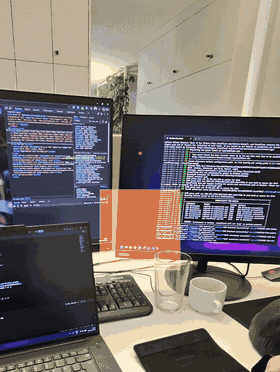

# mrbd-cube

A minimal Three.js web app for **Meta Ray-Ban Display (MRBD)** glasses. It shows a colored 3D cube in the lens that you rotate with swipes and reset with a pinch on the Meta Neural Band. Use it as a starting point for your own in-lens web apps.



## Features

- 600 × 600 px viewport matching the MRBD display
- Transparent background: black is see-through on the additive waveguide
- Unlit, high-contrast colors and white edges so the cube stays readable
- Gesture input via standard keyboard events (arrow keys and Enter)
- Render loop capped at 30 FPS, the display's content refresh rate
- Hot module replacement on the glasses through an HTTPS tunnel

## Requirements

| What | Notes |
| --- | --- |
| Meta Ray-Ban Display + Meta Neural Band | Set up and paired in the Meta AI app |
| Meta AI app with **Developer mode** on | Settings → App info → tap *App version* 5 times → Enable |
| Node.js 20+ and npm | For Vite and npx |
| Desktop Chrome | For local testing and the simulator extension |
| An HTTPS tunnel | [Cloudflare Quick Tunnel](https://developers.cloudflare.com/cloudflare-one/connections/connect-networks/do-more-with-tunnels/trycloudflare/) (no account needed) or [ngrok](https://ngrok.com/) |

> The glasses only load **HTTPS URLs with a publicly trusted certificate**. Plain `http://`, local IPs and self-signed certificates are rejected, so a tunnel is needed during development.

## Quick start

```bash
git clone https://github.com/firedragongamestudio/mrbd-cube.git
cd mrbd-cube
npm install
npm run dev
```

Open `http://localhost:5173` in Chrome and try the arrow keys and Enter.

In a second terminal, start the tunnel:

```bash
npx cloudflared tunnel --url http://localhost:5173
```

Copy the `https://<random-name>.trycloudflare.com` URL from the boxed line in the output. Warnings about a missing config file or the certificate pool on Windows can be ignored.

## Run it on the glasses

1. **Optional: preview in the simulator.** Install the *Meta Ray-Ban Display Web App Simulator* extension in Chrome, open your tunnel URL and check layout and controls with the on-screen D-pad. **Try On Glasses** in the simulator sends the app to the Meta AI app on your phone.
2. **Register the Web App.** In the Meta AI app open **App settings → Apps → Web Apps → Connect Web App** (older versions: *App connections → Web Apps → Add a Web App*). Enter a name and the tunnel URL, then tap **Connect**.
3. **Launch.** Put on the glasses, open the app grid and select your app; it appears at the bottom of the grid.
4. **Iterate.** Edit the code and save. Vite HMR pushes the change through the tunnel and the glasses update live. A middle pinch opens the Web App menu (Restart, Resume, Permissions) if you need a full reload.

> A Quick Tunnel gets a new URL every time it starts. After restarting `cloudflared`, update the URL in the Meta AI app.

## Controls

| Input on the glasses | Key event | Action |
| --- | --- | --- |
| Swipe left / right | `ArrowLeft` / `ArrowRight` | Rotate the cube 90° around Y |
| Swipe up / down | `ArrowUp` / `ArrowDown` | Roll the cube 45° around Z |
| Single pinch | `Enter` | Reset rotation to 0, 0, 0 |
| Double pinch (within 320 ms) | `Enter` × 2 | Switch color palette |
| Back gesture | `Escape` | Left to the system (exits the app) |

Meta documents that gestures arrive as arrow keys and Enter, but not which physical swipe maps to which arrow. Check the direction on your glasses.

## Project structure

```
mrbd-cube/
├── index.html        # 600×600 viewport, MRBD meta tags, canvas and status label
├── vite.config.js    # Allows tunnel hosts, routes HMR through port 443
├── src/
│   └── main.js       # Three.js scene, gesture handling, 30 FPS loop
└── docs/
    └── demo.gif
```

Key settings, in case you start from scratch:

- `index.html` needs `<meta name="viewport" content="width=600, height=600, initial-scale=1.0, user-scalable=no">` and `<meta name="mrbd-web-app-capable" content="yes">`, plus `overflow: hidden` on `html, body`.
- `vite.config.js` needs `server.allowedHosts: ['.trycloudflare.com', '.ngrok-free.app']` and `server.hmr.clientPort: 443`.
- In the key handler, call `preventDefault()` **only** for keys you handle, so the system Back action keeps working.

## Designing for the display

- **Black is transparent.** Clear to `0x000000` with alpha 0; dark objects and shadows disappear.
- **Use bright, unlit colors** (`MeshBasicMaterial`), and add outlines (`EdgesGeometry`) for legibility. WebGL always draws lines 1 px wide.
- **Keep text large:** 16 px minimum, 20–24 px for primary content.
- **Keep it light.** Cap rendering at 30 FPS and keep the bundle small to save battery and heat.
- No camera, microphone or notification APIs are available to Web Apps.

## Recording a demo

Open the quick-settings panel on the glasses and select **Display recording**. It records the lens content composited over the camera view, up to 1 minute per clip; a red dot shows while recording. Clips import to your phone's gallery through the Meta AI app. Meta lists this feature for the US (English) only.

## Troubleshooting

| Problem | Fix |
| --- | --- |
| `Failed to load url /main.js` | The script tag must point to `/src/main.js` |
| `cloudflared` not recognized | Use `npx cloudflared tunnel --url http://localhost:5173` |
| "Blocked request. This host is not allowed" | Add the tunnel domain to `allowedHosts` and restart Vite |
| Meta AI app rejects the URL | Use the HTTPS tunnel URL, not `http://` or a local IP |
| App stopped loading after a restart | The Quick Tunnel URL changed; update it in the Meta AI app |
| Blank or washed-out canvas | Use bright colors and edges; for layout debugging, clear to an opaque `0x1a1a1a` |
| No Web Apps entry in the Meta AI app | Developer mode is off (it can reset after firmware updates); re-enable it |
| Back gesture does nothing | Don't call `preventDefault()` on unhandled keys |
| HMR doesn't update on the glasses | Check `hmr.clientPort: 443` and that the tunnel is still running |

## Resources

- [Meta Wearables Developer Center – Web Apps: Build](https://wearables.developer.meta.com/docs/develop/webapps/build/)
- [Meta Wearables Developer Center – Web Apps: Test](https://wearables.developer.meta.com/docs/develop/webapps/test/)
- [Meta Wearables Web App toolkit (GitHub)](https://github.com/facebook/meta-wearables-webapp)
- [Meta Help – Record your display](https://www.meta.com/help/ai-glasses/951708387778102/)
- [Three.js documentation](https://threejs.org/docs/)
- [Vite server options](https://vite.dev/config/server-options)

## License

MIT – see [LICENSE](LICENSE).
